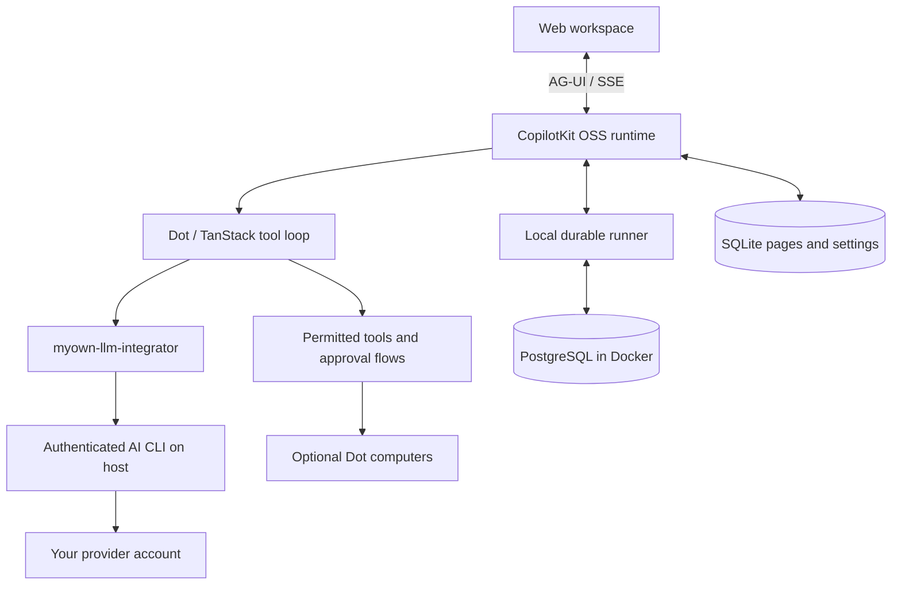

# My Own Dots

A local agent workspace powered by your existing AI subscriptions. Forked from [OpenDots](https://github.com/CopilotKit/OpenDots), part of MyOwnStack.

Give specialist Dots their own instructions and tools, chat with them, save and edit pages in Spaces, and schedule work. Inference uses the published [MyOwnLlmIntegrator](https://github.com/Handriantog/My-Own-LLM-Integrator) npm package. Conversation history lives in PostgreSQL running locally in Docker. The app and your authenticated AI CLI run on the host.

**The default setup needs no CopilotKit account or model API key.** CopilotKit's open-source UI/runtime and AG-UI still power chat and approval cards. Managed Slack and Automatic Learning are optional Intelligence-only features; realtime voice and third-party search remain separate opt-in services.

[Get started](#get-started) · [How subscription AI works](#how-subscription-ai-works) · [Local AI guide](docs/LOCAL-AI.md) · [Architecture](#architecture) · [Features](#features)

## Overview

My Own Dots is a starting point for building your own agent workspace. Clone it, define your Dots, connect your services, and adapt the interface and tools to your needs.

**A template, not a hosted product.** You run the application and configure its infrastructure. The template is in early development; the Features section below describes what's included and distinguishes local verification from connected-service testing.

### Spaces

A Space is a home for working documents. Dots appear separately in navigation and can be granted access to multiple Spaces in their settings. Each Dot has a default destination for saved pages; existing installations retain their original Space access. Browse pages in a searchable library, switch between grid and list views, and organize documents as nested subpages. Open a page in a focused visual editor with formatting, slash commands, and undo/redo. Write directly, save a conversation as a page, or ask a specialist to create and revise content.

Pages stay in the local SQLite workspace database. Their conversations persist in local PostgreSQL, with a separate conversation for each page and specialist. Page links connect the document workspace to Dot chat. Manual editing works before you start the conversation backend. Autosave reports its progress, failed saves retain your draft, and revision checks prevent stale edits from overwriting newer content. Markdown source mode remains available.

<div align="center">

<table><tr><td>

https://github.com/user-attachments/assets/d20c3405-4339-49e7-a799-43298728015c

</td></tr></table>

</div>

_Open a Space, navigate to its launch brief, ask Scout about the saved page, and continue in Dot chat. This recording uses live page chat and example launch content._

### Specialist Dots

Give each Dot a name, role, instructions, and permitted tools. A researcher can investigate a topic; a writer can turn findings into a draft. Inspect their work and control what they can do.

### Dot computers

Each Dot can have its own computer, using [OpenBot](https://github.com/CopilotKit/OpenBot)'s container supervisor and computer service. Its browser profile and workspace files persist across stop/start. The Computer panel exposes browser control, human takeover, files, terminal output, and activity, with browser, file, and shell permissions set per Dot. The application keeps service credentials on the server and derives a different computer credential for each Dot.

See [Computer setup](docs/COMPUTERS.md) to build the pinned services and connect your deployment. Computer tools require those services; an unconfigured template does not execute commands on your host.

<div align="center">

<table><tr><td>

https://github.com/user-attachments/assets/30b691c3-0f66-4964-9fdb-67d4feab5568

</td></tr></table>

</div>

_Ask Scout to open a website, summarize it, save notes, and verify the file. Every computer action in this demo is requested through chat; CopilotKit tool renderers show the live browser, saved file, and terminal output inline._

### Review before saving

Ask a Dot to show a draft before saving it. A CopilotKit human-in-the-loop card pauses the conversation for **Approve & save** or **Decline**. Approval creates the page in an authorized Space and returns a link; retries with the same draft recover that saved page. A changed draft needs a new review. The agent continues after your decision.

### Connections

Give a Dot tools from any MCP server, such as email, calendar, GitHub, or your own services. Read-only tools run on their own. Any other tool pauses for an **Approve & run** card in chat, and only your approval runs it. You can turn each tool on or off per Dot. See [Connections](docs/CONNECTIONS.md).

### Connected apps

Dots can use [Composio](https://composio.dev) to work with the owner's email, calendar, and other connected apps. Add `COMPOSIO_API_KEY`, restart OpenDots, then enable Connected apps in both the global settings and the Dot's settings. Adding the API key alone does not grant access.

You can limit each Dot to toolkit slugs such as `gmail` or `google_calendar`. A blank toolkit list allows every toolkit in the Composio project. OpenDots identifies the owner with `OWNER_ID`, so keep that value stable after connecting accounts. When a tool needs authentication, the Dot returns a Connect link in chat for the owner to complete the provider's sign-in flow.

These tools act on real accounts. Start with a read-only request and use a test account before trying write actions. See [Composio setup](docs/SETUP.md#composio) for configuration, permissions, testing, and data-sharing details.

### Text and calls

A continuous conversation keeps the Dot's avatar and status above the messages, with text and call controls close at hand. Work updates, source links, and call receipts appear in the timeline; a side panel shows results or the agent's computer.

Calls pair realtime speech with a separate compute agent, so the conversation can continue while longer work runs. Both use the same conversation context and tool permissions. The call screen includes a live timer, separate user and Dot captions, microphone mute, speaker mute, and a minimized view for continuing in chat. Voice needs separate provider configuration.

<div align="center">

<table><tr><td>

https://github.com/user-attachments/assets/3c06cf71-39ed-4e2b-b846-5463b2722389

</td></tr></table>

</div>

_Connect, talk, mute, minimize, and return to chat. This is a silent screen capture of a real call, with waiting time trimmed and playback accelerated._

### Slack

With the optional Intelligence backend, mention a Dot through a managed Slack connection using Channels SDK, then continue in its thread. The integration follows [OpenTag](https://github.com/CopilotKit/OpenTag), with an explicit workspace/user allowlist and a selected specialist. See [Slack setup](docs/SETUP.md#slack) to connect your deployment.

<div align="center">

<table><tr><td>

https://github.com/user-attachments/assets/27d03a6c-a9e0-4c29-8d96-fafe0fbae20f

</td></tr></table>

</div>

Bring your agents into Slack with [Channels SDK](https://github.com/CopilotKit/channels-sdk). See the [managed Channels documentation](https://docs.copilotkit.ai/intelligence/channels) to connect them through CopilotKit Intelligence.

## Desktop companion (macOS)

A separate desktop entry point runs one recolorable plush Dot above ordinary application windows. It supports continuous roaming, exposed window-edge physics, pinching pickup, local sound effects, and menu-bar appearance/sound controls. Window play uses a bundled Swift geometry observer and requires Accessibility; a clear floor-only mode remains available without permission.

Run `npm run desktop:dev` to build and launch, or `npm run desktop:package` for a self-contained Apple Silicon `.app` and ZIP. The local build is ad-hoc signed and is not notarized. Desktop chat/voice/agent execution and Windows/Linux adapters remain future work. See the [desktop guide](docs/desktop/README.md), [artwork notes](docs/desktop/asset-notes.md), and [verification evidence and limits](docs/desktop/verification.md).

## Architecture

### AG-UI connects the agent to the interface

[AG-UI](https://docs.ag-ui.com/introduction) carries streamed messages, tool calls, and agent state between the backend and CopilotKit components. Computer activity appears inline as the agent works; human-in-the-loop cards pause a tool call for your decision before it continues.

TanStack AI owns the tool loop and validation. A subscription adapter sends each model step to MyOwnLlmIntegrator, which invokes your logged-in CLI and returns a structured result. CopilotKit's open-source SSE runtime uses a local durable runner backed by PostgreSQL. SQLite holds pages, application metadata and background-work state. The integrator returns complete steps rather than token streaming.



Provider selection and credentials stay server-side. Browser requests cannot choose executables, change the model provider, or bypass application tool permissions. The selected CLI still sends inference to its provider; this is local storage and subscription access, not offline AI.

### How subscription AI works

The default path uses your **Codex CLI signed in with ChatGPT**. My Own Dots calls the installed `myown-llm-integrator@0.1.0` npm package, which runs its bundled Python engine and invokes that CLI. The CLI uses your existing account session; the app does not need an OpenAI API key or a CopilotKit Intelligence subscription. Subscription usage limits and model access still apply.

Each conversation turn follows this flow:

1. The server loads saved conversation history from PostgreSQL and combines it with the Dot's instructions, permitted context, and tool definitions.
2. The subscription adapter sends the current model step to Integrator's `runAgent`, with a JSON schema describing an answer and proposed tool calls. Integrator handles the provider process, timeouts, cancellation, and structured-output validation.
3. The CLI returns an answer or tool decisions. TanStack AI and the application's tools validate those decisions and enforce permissions. Actions that require approval pause in the existing review cards; the provider CLI is instructed to return decisions rather than execute application actions itself.
4. Tool results are supplied to the next model step until the Dot finishes or waits for your decision. The local runner persists messages, tool results, run events, and state so the conversation can be reopened after a restart.

Scheduled turns and research summaries use the same subscription integration. Output arrives after each model step completes, rather than token by token. Stopping a turn propagates cancellation to the provider process. Provider restrictions are not an operating-system sandbox; see the [Local AI guide](docs/LOCAL-AI.md) for operational limits.

The app, Python engine, and authenticated CLI run **on the host**, where the CLI can access its normal login profile. Docker runs PostgreSQL through [`compose.local.yml`](compose.local.yml). SQLite continues to hold pages, Dots, permissions, memories, and schedules. This independent local conversation backend replaces the persistence needed by this app; it does not reproduce Intelligence's managed Slack service. Local retrieval, Compact, and Dream provide independent memory and learning; see [the memory guide](docs/MEMORY.md).

After `npm run setup:local`, the relevant `.env` defaults are:

```dotenv
CONVERSATION_BACKEND=local
LLM_BACKEND=subscription
LLM_PROVIDER=codex
LLM_MODEL=
AGENT_RUN_TIMEOUT_MS=900000
DO_NOT_TRACK=1
```

Leave `LLM_MODEL` empty to inherit the provider's configured model. To use another supported CLI, install it, sign in, change `LLM_PROVIDER` (for example, `claude-code` or `gemini`), and restart the app. Other CLIs retain their own authentication and billing behavior. The [Integrator provider guide](https://github.com/Handriantog/My-Own-LLM-Integrator/blob/main/docs/providers.md) describes provider-specific requirements.

The two backends are selected independently. `LLM_BACKEND=openai` enables the original API-key model path; `CONVERSATION_BACKEND=intelligence` enables the original hosted conversation path. Neither is selected automatically when an old key is present, and failures do not silently fall back to hosted services. The sibling Integrator source checkout is not required to run Dots; changes there need a package update before this app uses them.

## Get started

Install **Node.js 24+**, **Docker with Compose**, **uv**, and a supported AI CLI. Log in to that CLI with your subscription account (Codex is the default).

```sh
git clone https://github.com/Handriantog/My-Own-Dots.git
cd My-Own-Dots
npm ci
npm run setup:local
npm run conversations:up
npm run setup:llm
npm run llm:check
npm run dev
```

Open **http://127.0.0.1:5173**. `setup:local` generates `.env` and database credentials; existing nonempty settings are preserved. The configuration check confirms the CLI is available; a real chat confirms authentication and model access.

Set `LLM_PROVIDER` to choose another integrator provider and optionally set `LLM_MODEL`. Restart after changes. See [Local AI setup](docs/LOCAL-AI.md) for supported configuration, migration, backups, troubleshooting and optional services.

## Data and privacy

The local Docker volume stores conversations, tool results and run events. SQLite stores pages, settings, curated memories, revisions, change receipts and schedules. PostgreSQL also stores memory evidence indexes, checkpoints and maintenance jobs. Back up both stores and keep `OWNER_ID` stable. Stopping Docker preserves its volume; deleting the volume deletes conversation history.

The selected provider receives conversation context and authorized tool results. Web research is disabled by default. Explicitly selecting Parallel sends queries and selected URLs to that service. Composio, voice, managed Slack and computer services only apply when configured. Local mode disables telemetry by default with `DO_NOT_TRACK=1`.

Existing hosted conversation history is not automatically copied into the local database. Keep the old backend configuration to access or export it. The original [Intelligence deployment instructions](docs/SETUP.md#hosted-intelligence) remain available for explicit compatibility mode.

## Features

| Area                       | Included                                                                                                                              |
| -------------------------- | ------------------------------------------------------------------------------------------------------------------------------------- |
| Spaces and Specialist Dots | Saved names, role instructions, and per-Dot research and memory permissions                                                           |
| Pages                      | Searchable library, visual editor, slash commands, autosave, and revision checks                                                      |
| Conversations              | React SDK chat and Threads integration, page-specific conversations, and source links                                                 |
| Slack                      | Optional Intelligence backend only: managed Channels with workspace and user allowlists                                               |
| Calls                      | WebRTC speech, delegated compute, bounded sessions, hangup, and timeline receipts                                                     |
| Background work            | Scheduled server-side turns in their original conversation, with pause and retry controls                                             |
| Browser                    | Separate read-only public-page service with page capture and navigation limits                                                        |
| Dot computers              | Per-Dot browser profiles, files, shell, takeover, permissions, and action records through OpenBot                                     |
| Connections                | Per-Dot MCP servers, Composio connected apps, per-tool access, and owner approval for MCP write actions                               |
| Appearance                 | System, light, and dark themes; dark colors are derived at build time from the light styles                                           |
| Memory                     | User-managed preferences that permitted Dots can use                                                                                  |
| Automatic Learning         | Local opt-in Dream with review/restore and automatic Compact; [memory guide](docs/MEMORY.md). Intelligence learning remains optional. |
| Deployment                 | Host app and subscription CLI, Docker PostgreSQL, optional computer/browser containers                                                |

Scheduled tasks run in their original conversation. If a worker stops or its lease expires during a run, OpenDots marks that run **Interrupted** and waits for an explicit retry. Review its pages and computer actions, then use **Retry after review** when appropriate. Completed effects may already be present even when a run has no final result.

Local checks cover setup, subscription tool decisions, durable conversation replay, permissions, SDK failure handling, and browser isolation. Automated inference uses fixtures, including the real npm/Python subprocess and SSE runtime with a dedicated PostgreSQL test database. **On October 16, 2026, a real Codex subscription completion succeeded; browser checks covered chat, page saving, history reload, and approving or declining drafts with fixture inference.** This does not establish live compatibility for every provider.

The following connected-service demos are inherited upstream verification: **Live Intelligence, model responses, and page-context chat were verified on September 29, 2026.** Live OpenBot computer browsing, file creation, shell verification, and file persistence across stop/start were also verified locally. Live Realtime speech, call controls, and receipt persistence were verified locally on September 30, 2026. Slack and spoken compute delegation still need connected-service verification. See [recording notes](docs/demos/README.md) for the demonstrated flows and limits.

In optional Intelligence mode, Automatic Learning routing and skill delivery are configurable. Cloud schedules, eligible-thread counts, and published-skill delivery still need connected-service verification. Skills require review and publication in Intelligence; existing conversations without a container are not enrolled retroactively.

This is a single-owner starting point. Shared editing, invitations, file uploads, and interactive page embeds are not included. Schedules are recurring instructions, not a complete goal or event-trigger system. Specialist Dots have separate roles and conversations; multi-Dot group conversations and automatic delegation are further work.

### Extending the template

- Add identity, Space membership, and shared page editing for multi-user deployments.
- Add file attachments and richer page content.
- Add event triggers and a persistent responsibility lifecycle.
- Extend tools and approval flows for your own workflows.
- Add richer artifacts, connected-app context, and specialist coordination.

## Contributing

See [Contributing](CONTRIBUTING.md) for development guidance and [Security](SECURITY.md) for reporting issues. Contributions should describe the workflow they enable, include verification evidence, and distinguish live integrations from fixtures.

## References

- [AG-UI documentation](https://docs.ag-ui.com/introduction)
- [CopilotKit documentation](https://docs.copilotkit.ai/intelligence/overview)
- [Channels SDK](https://github.com/CopilotKit/channels-sdk)
- [OpenMuse](https://github.com/CopilotKit/OpenMuse)
- [OpenBot](https://github.com/CopilotKit/openbot)
- [OpenTag](https://github.com/CopilotKit/OpenTag) — Channels SDK integration reference

## License

Original OpenDots code is [MIT](LICENSE). The `myown-llm-integrator` dependency is AGPL-3.0-only; see its [license and attribution](https://github.com/Handriantog/My-Own-LLM-Integrator#attribution-and-license). Other dependencies retain their licenses.

## Public-web research

Web research is disabled by default. Set `WEB_SEARCH_PROVIDER=parallel` to explicitly enable Parallel in live research and Dot conversations. Ask a topic-only question to discover and read up to five sources, or supply URLs to extract them directly. Sources are saved with their links. A browser worker is not required for this research path; computer tools remain available for interactive work.

`WEB_SEARCH_PROVIDER=browser` preserves the existing URL-only browser reader, and `WEB_SEARCH_PROVIDER=disabled` disables these research tools. Workspace and Dot research permissions, pause and cancellation controls still apply. Sample research remains fictional and does not contact a provider.

Queries, requested URLs, a stable session identifier and the research objective are sent to `https://search.parallel.ai/mcp`. Memories and complete conversations are not automatically forwarded to Parallel. Model-selected objectives may still contain context from the conversation. The anonymous service is free for light use with provider-managed limits; set `PARALLEL_API_KEY` on the server for production or higher limits. Provider errors and empty results are reported rather than replaced with invented evidence. See [Parallel Search MCP documentation](https://docs.parallel.ai/integrations/mcp/search-mcp).

### Local memory verification

The local memory extension adds bounded essentials, on-demand recall, manual/automatic Compact and Dream, revision review and restore. See [MEMORY.md](docs/MEMORY.md) for defaults, storage, commands, measured latency and the distinction between deterministic fixture tests and the live Codex smoke. Voice changes are deferred.
