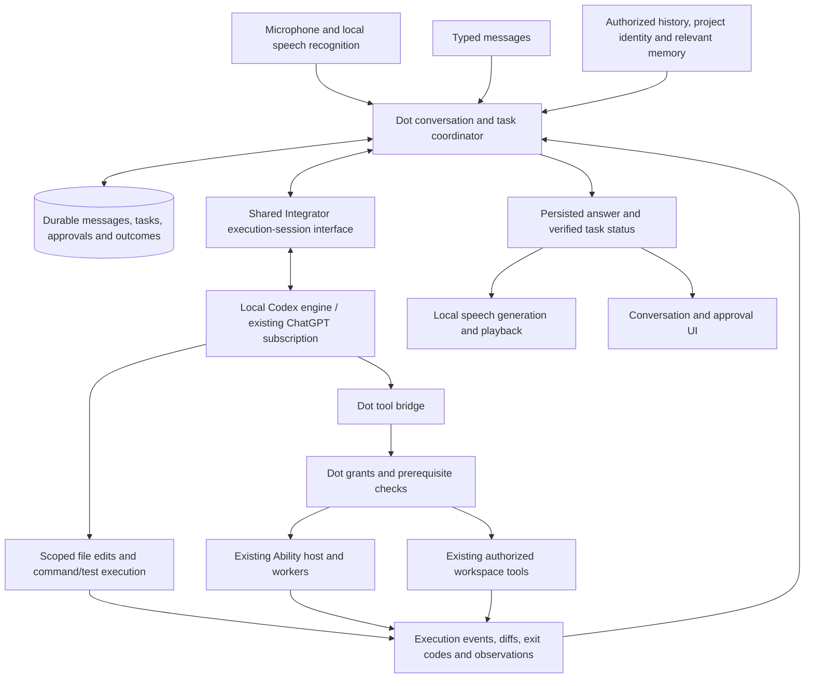

# Codex-first voice agent: reliability design

25 October 2026 · Design approved by the owner · Implemented · Owner reported successful use; broader acceptance limits remain

## Decisions and intended result

The owner has selected **Codex first**, **local speech recognition and generation**, and **no additional subscription or separately billed API requirement**. The required baseline is correct folder approval, dependable installed Abilities and project debugging through inspection, edits and tests. High voice is central to this baseline.

The owner approved this design and requested an explanation of its tradeoffs before implementation. Approval is recorded; another approval of the same design is not required. The performance targets remain provisional measurements to qualify, not achieved results. See the [development rules](../development/agent-reliability.md) and [postmortem](../postmortems/2026-10-25-agent-reliability.md).

The first milestone is a complete journey: during a call, ask Dot to diagnose a failing disposable project, confirm the intended folder and execution access, let it reproduce and patch the problem, hear the actual test result, then continue the same task by text or voice. Ability start/status/stop and recovery must pass alongside this journey.

Other providers, wake-word listening, cross-device calls, automatic self-deployment and a storage rewrite are outside this milestone. Keep the existing call entry points. The user can assign background work while a call is active; ending the call stops capture/playback, not already accepted work. A separate stop-task control cancels work. No capability is described as universally successful on arbitrary packages or projects.

## Tradeoffs to carry into implementation

- **Capability and continuity versus latency:** routing ordinary voice and text through the same Codex engine removes the small local classifier as an execution gate and adds a coding workflow. It also puts subscription inference in the path of casual conversation that previously could be local. A quick receipt acknowledgement does not substitute for a useful answer; measure the complete audible delay.
- **No additional service subscription versus existing allowance consumption:** local speech avoids a required paid speech service, but ordinary conversation as well as work uses the existing Codex allowance. It competes with the owner's other Codex usage. Quota exhaustion blocks new reasoning; do not silently switch to billed APIs or buy credits.
- **Local audio versus remote reasoning:** microphone processing and synthesis stay on the device. Transcripts and authorized project context may reach the selected reasoning provider. Offline speech processing does not make this design a fully offline intelligent companion.
- **Local speech control versus device and speech-quality work:** models require storage, memory and compute. Recognition errors, echo, interruption quality and speech naturalness need their own evidence. Replacing the task engine does not solve them, and the text-based reasoning path does not inherently interpret vocal emotion.
- **Simple execution ordering versus conversation while working:** the initial one-executing-task-per-Dot rule avoids competing mutations. Status and stop remain responsive, but unrelated conversation and tasks may queue during a long coding run. Independent simultaneous conversation and work would require an explicit extension; do not quietly claim that first-version behavior.
- **Reuse versus provider dependence:** reusing Codex avoids rebuilding much of a coding engine, while tying the first supported path to its interfaces, authentication, availability and version compatibility. App Server must pass qualification; pinning versions adds maintenance and controlled-upgrade work.
- **Useful authority versus permission boundaries:** inspect/edit/test needs more authority than chat. Correct project grants should reduce mistaken or repeated requests, but legitimate OS consent and requests outside the approved scope remain. This is not unrestricted access to every project.
- **A testable first milestone versus breadth:** the new path starts with Codex on the target macOS arm64/SQLite setup and qualified Ability packages. Other providers/platforms, wake words and automatic self-deployment are deferred. Existing legacy paths remain without inheriting the new reliability claim.

The design's expected reliability improvement is a hypothesis to test against the acceptance journeys. It is not established by adoption of Codex alone. If compatibility, enforcement or voice performance cannot meet the stated boundary, stop migration and return the evidence and alternatives; do not weaken the boundary to finish the implementation.

## Approaches

| Approach                                                                       | Tradeoff                                                                                                                                                      | Decision                                                                                                                        |
| ------------------------------------------------------------------------------ | ------------------------------------------------------------------------------------------------------------------------------------------------------------- | ------------------------------------------------------------------------------------------------------------------------------- |
| Expand Dot's existing structured-decision loop into a complete coding runtime  | Preserves the current Integrator contract, but requires building command execution, coding sessions, approvals and recovery ourselves                         | Retain as a fallback design direction if a reusable engine cannot meet the required boundaries; do not develop both in parallel |
| Use the complete Codex execution engine through an explicit shared integration | Reuses the coding workflow; Dot still owns its product context, grants, Abilities and evidence. Integration and version compatibility remain substantial work | Recommended architecture for the owner's Codex-first scope; qualify the transport and sandbox before implementation rollout     |

The existing `runAgent`, `createAgentSession` and `createProviderSession.runDecision` APIs remain inference-only. Do not turn on native tools inside them: Researcher and existing Dot flows depend on that boundary. Propose an additive execution-session interface in MyOwnLlmIntegrator, with transport/provider mechanics there and application policy in Dot. A built, versioned npm package pinned by integrity is needed before Dot consumes this interface; editing the sibling checkout does not update the installed package.

The first transport candidate is local Codex App Server over stdio. Official documentation describes thread/event/approval integration and subscription authentication, but also marks App Server experimental. Those facts justify a qualification step, not a reliability claim. [App Server](https://learn.chatgpt.com/docs/app-server), [authentication](https://learn.chatgpt.com/docs/auth).

### Compatibility history and current decision

At design time, the shell resolved `codex-cli 0.163.0`. The installed Integrator's `provider_session.py` explicitly accepts only `codex-cli 0.157.1`; its provider-session documentation records the same pin. That restricted session path would reject the shell's current version. This has **not** established which executable the running packaged app uses or whether that path is enabled there.

The additive execution adapter now qualifies and pins CLI 0.163.0 independently; the legacy inference-only provider-session contract is preserved. This mismatch is resolved for the Codex execution path, not a pending request to downgrade the CLI.

The qualification report must identify the executable actually used by each candidate, its version, the Integrator version and the reviewed upstream revision. Review the proposed version and dependencies before installation or execution beyond version inspection. Do not downgrade the owner's global CLI, change its login, remove version checks or accept arbitrary newer versions to make a demo pass. An incompatible candidate reports a specific compatibility error and does not start a task.

## Codex execution flow

The Codex process runs locally; its reasoning requests use the user's subscription over the network. Audio processing stays local. Transcripts and relevant authorized context reach the reasoning provider. No raw microphone audio is needed by Codex in this design.

Every ordinary finalized utterance enters the same agent path as typed input. The current Qwen classifier no longer decides whether a task reaches the execution engine, and its free-chat branch no longer invents separate action replies. Reuse local recognition and synthesis initially; decouple those operations from the current worker's compulsory router loading. A speech model replacement is not a prerequisite. Keep Dot personality and approved preferences in the shared context.

Local microphone controls and status playback do not need a model decision. Barge-in stops speech promptly without claiming that a running command has been canceled. Explicit task cancellation has its own acknowledged lifecycle. Do not interpret quoted, hypothetical or negated stop requests as permission to execute or cancel unrelated work.

## Ownership and session contract

Dot owns the canonical conversation, project bindings, grants, task lifecycle and externally observed results. Codex owns its reasoning/tool execution session. Integrator owns the provider transport and process lifecycle. Codex session history is a cache of authorized working context, not a replacement for Dot's records.

Use a stable mapping of owner, Dot, conversation, task and permission generation to provider thread/turn identifiers. Record the mapping before execution. Each accepted input gets a durable deduplication key; reconnect and transport retry cannot create another task for the same input. Do not share provider sessions across owners or Dots. Project or grant changes require revalidation and, when the old session contains disallowed context, a new session built from the current authorized projection.

The additive Integrator interface needs capability/version inspection, start, resume, interrupt, close, events and an explicit approval-response channel. Exact API names are left to the builder. App policy never comes from arbitrary model-supplied paths or scope IDs. Unsupported events or permission requests stop the affected run with a diagnostic; they must not become implicit approval.

The initial coordinator permits one executing task per Dot. Incoming status/cancel requests remain responsive; other owner messages are persisted and shown as queued until they can safely steer or start another turn. Do not silently drop them or allow competing mutations. Background work survives closing the call. App/process loss produces an interrupted task to reconcile, not an automatic replay.

Reuse current conversation repositories, job leases, task links and UI events where their contracts fit. Keep legacy records readable. The first qualification and rollout target the existing macOS arm64/SQLite High-voice configuration; preserve other storage backends and their current behavior, but do not advertise the new execution path there until it has equivalent coverage. No second task database or broad database migration is proposed.

## Project identity and permission

Resolve the project using an explicit owner path, the conversation's confirmed project or a known project binding, in that order. Existing metadata-only folder resolution may propose a candidate. Never infer the source checkout from the app's data directory, package path or an arbitrary parent folder. If candidates remain ambiguous, ask for the project rather than requesting broad parent access.

Store the selected canonical path and filesystem identity separately from an unapproved hint. Selection revisions must survive UI polling. Approval binds the exact selection revision, Dot/task, access scope and expiry; a stale card cannot grant a replaced path. Denial, cancel, revocation and restart must not resurrect the abandoned request.

Existing read/edit grants do not authorize arbitrary command execution. Add an explicit project execution grant: the chosen workspace, read/edit/run scope, network policy and lifetime are shown in the existing approval pattern. Routine authorized work proceeds within that grant. Additional paths, network access or consequential operations outside it require a specific request, not blanket full access. macOS consent remains an OS-owned step and is never treated as approved merely because Dot's folder card was approved.

For this repository, implementation uses a project-local `.worktrees/` checkout. Other projects follow their own instructions. Creating a worktree may need access to Git metadata outside the linked checkout; resolve and disclose that bounded requirement rather than silently granting the entire parent directory. Preserve unrelated changes and never reset a dirty checkout as recovery.

Native Codex file and command tools must be constrained by an effective sandbox matching the approved scope. Merely setting `cwd` is insufficient. Before adoption, test reads, writes, child processes, symlink/path escapes, network restrictions and revocation against the actual installed engine. Inspect inherited configuration, hooks, plugins and MCP servers; only explicitly admitted integrations may be active. Credentials remain owned by the normal provider login; do not copy them into a synthetic home or trace.

If the chosen engine cannot enforce the advertised scope, this design cannot ship as written. Return to a narrower brokered executor or another reviewed isolation approach and update the design. Do not bypass sandboxing or broaden access to pass acceptance.

## Dot tools and installed Abilities

Expose existing permitted Dot tools through a scoped local tool bridge; MCP over stdio is the first bridge candidate to qualify. The host binds each bridge to its owner/Dot/task and permission generation; the model cannot choose another identity. Keep provider integration mechanics in Integrator and tool authorization/dispatch in Dot. The bridge must not expose a new unauthenticated network listener.

The Ability service retains installation, package trust, assignment, grants, private results and worker isolation. Native coding tools must not bypass an Ability's host API. Discover relevant tools without injecting the entire installed catalog into every turn; test catalog size and multi-turn context budgets. A retrieved tool must still pass current host admission at invocation time.

Readiness must distinguish compatible/installed, enabled, assigned, configured, host connected, OS permission and helper ready. Failure includes a stable category, known missing prerequisite, observation time and recovery step. Start/status/stop need correlated current observations. Private results stay private; expose safe state and error metadata to the agent so it can reason about failures.

Tool completion and outcome verification are separate. Packages define observable success and status checks where possible. A timeout after dispatch is uncertain until reconciled. Never blindly retry a mutating call. An unsupported package stays visibly unsupported; installing it does not confer a success guarantee.

## Execution evidence and recovery

Persist state transitions and correlation identifiers before dispatch. Represent received, queued, running, waiting for approval, completed, failed, canceled, interrupted and uncertain states. A provider turn ending is evidence that the turn ended, not that an external goal was achieved.

For coding work, retain the executed command and workspace, exit status, bounded output/artifact references, patch and relevant test results. The completion summary distinguishes reproduced, changed, verified and still unverified. For Abilities, retain safe action receipts and post-action observations. Render and speak status from this evidence; do not let a second local language model reinterpret a failed action as success. This reduces false-completion risk; it does not provide a general semantic proof of arbitrary tasks.

Cancellation stops queued dispatch and requests cancellation of the active engine/worker. Mark canceled only after confirmation; otherwise mark interrupted/uncertain and report what might already have happened. Revoking access invalidates pending approvals, stops affected execution and prevents later events from using the old grant. Reconcile on restart against both durable records and available engine/host state; missing evidence is uncertainty, not permission to replay.

Self-debugging starts with runtime diagnostics and build/source identity. If source changes are needed, use an approved development checkout, isolated data and the normal patch/test workflow. Switching the running app to the repaired build remains a deliberate handoff. Preserve a known recovery build and a diagnostic path outside the main agent, because a crashed runtime cannot diagnose itself through its own voice interface.

## Speech and responsiveness

Keep recognition, endpoint detection, synthesis and playback local after model installation. Reuse the current pinned speech assets initially and qualify their standalone recognition/synthesis behavior. Do not feed Codex output into a local conversational model for rewriting. Persist text before speech; generation IDs prevent old audio from playing after interruption or a newer answer.

A local acknowledgement may say the request was received only after durable admission. It must not say work started before execution starts. Useful engine progress can then stream to the conversation; speak short updates when relevant rather than narrating every tool call. Failed synthesis leaves the readable result available and reports a voice failure; it does not retry the action.

Provisional warm-session targets for review: p95 visual input acknowledgement within 1 second of finalized recognition (no automatic spoken admission receipt), p95 speech interruption within 300 ms of detected barge-in, and p95 first substantive spoken response within 5 seconds of finalized recognition for short conversational requests. Report cold start, endpoint detection and provider wait separately so the measurement cannot hide perceived delay. These are proposed targets, not measured promises. Task completion time depends on the task; record dispatch and completion separately. If the targets are infeasible, return measurements and options before changing them or replacing local speech with a paid service.

## Approved implementation sequence (historical plan)

1. **Qualify the integration.** Inspect the exact Codex revision/configuration and resolve the known version mismatch without altering the owner's global setup. In a disposable workspace, prove subscription-only authentication, scoped native edits/commands, tool bridging, approval mapping, interruption and reconnect. This was the first engineering stage; the qualification record below contains its completed evidence and limits. Stop if enforcement or the supported interface is inadequate.
2. **Establish shared task and project state.** Add the execution-session interface, coordinator, project grants, evidence model and diagnostics. Verify through text and finalized voice transcripts together; avoid a separate text-only architecture.
3. **Complete the local speech path.** Remove the classifier as an execution gate, connect the existing local speech components, preserve context across follow-ups and handle interruptions. Measure the full pipeline on the target machine.
4. **Qualify Abilities and coding end to end.** Exercise the same start/status/stop, permission and recovery contracts across both channels. Produce a verified patch for a disposable project and a reviewable Dot patch in its worktree.
5. **Package and hand off one identified candidate.** Run the automated profiles, held-out model/speech cases, real native checks and clean shutdown. Integrate the exact version pairing only after acceptance.

Keep the current implementation available during development. Opt the test Dot into the new engine explicitly, bind its session to that engine and never automatically switch engines mid-task. Switching back requires reconciling active work; preserve transcripts and evidence. Existing other-provider paths remain available as legacy behavior, without new reliability claims.

## Acceptance and future automation

Use disposable projects, dedicated databases and test fixtures. No owner application data or live account mutations are assumed by this design. Recordings of the owner's microphone are not implied permission; use checked-in synthetic/consented clips and a separately arranged live call check.

The initial proposed qualification set has at least 10 distinct folder/approval cases, 10 Ability lifecycle cases and 5 debugging cases, each exercised through typed input and held-out speech/paraphrases. Repeat the live behavioral set three times on the same candidate and report every attempt. Keep tuning cases separate; once a held-out failure informs a repair, retain it as a regression and replenish independent evaluation cases. Include ordinary conversation, cross-channel references, correction, completed-task follow-up, stop, denial and ambiguous project names. Start with the existing local Mouse Mover and Spotify Local packages plus a deterministic fixture Ability; real effects require their own controlled acceptance.

All required deterministic cases and the initial functional journey set must pass before handoff, with zero observed unauthorized actions, silent paid fallbacks, duplicate mutations or false completion claims. Report failures rather than averaging them away. Repetitions establish reproducibility on the tested set, not a production reliability percentage. The provisional latency targets above need review against measurements before release.

| Automation                                                              | Required evidence                                                                                                                           | Status                                                                            |
| ----------------------------------------------------------------------- | ------------------------------------------------------------------------------------------------------------------------------------------- | --------------------------------------------------------------------------------- |
| Shared `verify:core` / `verify:macos` commands and PR evidence template | Existing checks cannot silently omit required database/native prerequisites                                                                 | Local core and macOS profiles pass; current-commit GitHub CI is a release step    |
| Execution compatibility probe                                           | Exact engine/package pair, auth mode, admitted configuration, tool and sandbox capabilities; no task starts on incompatibility              | Implemented and checked against CLI 0.163.0                                       |
| Cross-channel journey harness                                           | Same semantic requests, approvals and failure injections exercise the actual coordinator, repositories and engine adapter                   | Implemented; source and packaged live reports retained                            |
| Speech isolation and behavioral evaluation                              | Recognition/synthesis work with speech-process external network denied after setup; subscription failure never enables a billed API         | Implemented; source and packaged live reports retained                            |
| Candidate manifest and handoff check                                    | Source commit/patch identity, app hash/location, engine/Integrator/model/Ability versions, storage mode and fresh prerequisite observations | Build identity, package smoke and owner launch verified; physical limits recorded |
| Native and recovery tests                                               | Real object destruction, helper starvation, process loss, stale selection, revoked grant and uncertain effects are handled without replay   | Extended, including real process loss and speech-worker lifecycle                 |

A manifest must not contain credentials or private chat. A rebuild invalidates package acceptance; engine/model/Ability/configuration changes invalidate affected results. Preserve failed attempts and skipped checks. The owner receives one identified candidate and known recovery path, rather than discovering which worktree was launched.

## Builder discretion and outstanding validation

The builder may choose internal module boundaries, event batching, opaque identifier formats and fixture layout, provided these contracts hold. Do not add dependencies when existing reviewed components suffice. New packages, binaries and model revisions require the repository's dependency review.

Unknowns are explicitly bounded: effective sandbox controls and local tool bridging on the selected CLI, real speech latency, model task quality and the engine's recoverable session behavior. Stage 1 resolves transport/enforcement feasibility before migration. Later stages resolve behavioral and performance acceptance. Other providers remain deferred until their own adapters satisfy the same tests.

The design deliberately does not promise arbitrary-task success or autonomous repair of an unstartable application. It promises an implementable route toward the owner's baseline, observable limits, and a process that prevents incomplete evidence from becoming another reliability claim.

## Design verification

A fresh builder review found no important unanswered planning questions beyond the qualification work explicitly assigned above. Formatting, local document links and whitespace checks passed. This is review of a proposed design, not validation of runtime behavior. Subsequent implementation and owner-test evidence are maintained in the qualification record; this paragraph describes the earlier design-only checkpoint.

## Recorded implementation decisions

The publishing session was unavailable (npm HTTP 401). The test candidate installs a vendored `myown-llm-integrator@0.3.0-rc.1` npm tarball pinned by lockfile integrity; public registry publication remains a release task. Dot still consumes the installed package, not sibling source.

Repeated technical-text tests found that LFM interleaved synthesis and both sampled and greedy sequential synthesis can miss their audio terminator. The Codex High path therefore uses local LFM recognition and the installed macOS Samantha voice for synthesis, with network and direct audio-device access denied to the worker. Readiness checks the installed voice and a file-only synthesis. This changes the speaker profile while preserving local audio and no additional subscription. Embedded `[[` speech commands are rejected rather than interpreted; the canonical answer remains in chat. Basic/Medium and the legacy local-conversation path retain their separate contracts.

Speech interruption drops pending playback and revalidates source/grant authority. A synthesis already in progress drains under the call lifetime before the shared worker accepts the next utterance. Interruption latency and next-turn availability are separate measurements.

The implementation uses Codex dynamic host tools instead of a separate MCP bridge process. Qualification details and remaining limits are maintained in [the qualification record](../development/codex-execution-qualification.md). Historical stage descriptions above preserve the approved design sequence; they do not override that current evidence.

### Voice and recovery decisions to preserve

The owner subsequently approved Qwen3-TTS for High/Codex speech, with nine selectable voices. LFM recognition and Codex task reasoning remain separate. Medium keeps Kokoro. See the current [High setup and evaluation](../desktop/local-voice-calls.md#high-setup-and-task-behavior); the earlier Samantha fallback is historical, not the current backend.

Casual replies and queued requests do not receive canned admission speech. Before substantial work and after an approval, the task agent gives one short, contextual next step; High speaks that persisted commentary before the final result. Pending approval does not occupy the Dot’s execution slot. Each approved task keeps its own selected folder and resumes through the shared queue, while unrelated conversation can continue. Mention the pending decision only when it is relevant. Status, stop and actionable blockers remain spoken. Persist the generated reply in the call transcript, wait for native warmup before synthesis and revalidate authority/generation after awaited writes. Do not restore canned acknowledgements as a latency workaround. Full answer latency and physical listening quality have separate acceptance gates.

The durable voice inbox introduced SQLite schema 6; schema 7 narrows the per-Dot execution constraint to running tasks so approval waits can coexist. Known schema 2–6 archives remain readable and upgrade on restore/open. This migration supersedes the original no-migration assumption without creating a second task database. A testable self-debugging agent can inspect/edit/test an approved development checkout; it does not automatically replace its running app.
