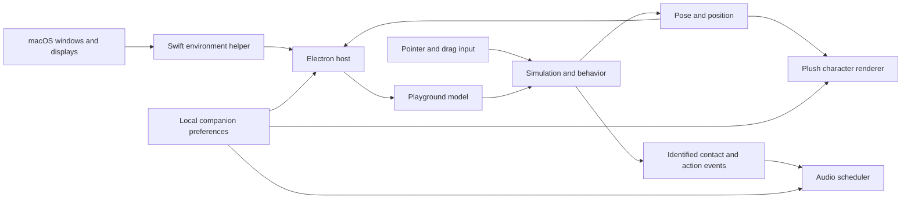

# Desktop Dot companion

Status: design ready for owner review. The desktop application, window tracking, character rig, physics, and runtime audio integration are not implemented. An original sound audition pack exists; the owner found some effects too rough and explicitly deferred refinement.

## Purpose and agreed scope

My Own Dots will have a desktop companion that feels like a small living creature sharing the user's computer. The first release runs on macOS and displays one plush Dot. It explores the desktop, walks on exposed window tops, climbs edges, hangs, jumps, falls, lands, rests, and responds when picked up. It stays visible above ordinary application windows, including when another application becomes active. Users can change its body color without changing its identity or requiring another animation set.

The owner confirmed these requirements during the design discussion:

- One visible Dot and one character type for this release.
- Preserve the existing furry plush appearance. Use the blue character in `public/dots/blue.png` as the master visual reference, including its face, proportions, feet, arms, and headphones.
- Freely explore the available desktop surfaces; do not restrict autonomous activity to a home corner.
- Treat other applications' windows as physical playground surfaces. Support standing on their top edges, climbing their sides, and falling when support disappears.
- Allow the user to click and drag Dot.
- Maintain a continuous body and identity. Ordinary movement must not teleport, snap between unrelated poses, slide planted feet, or restart animations unpredictably.
- Provide appropriate sound for meaningful interactions and physical events, including falls and bumps. Keep the current audition assets provisional; improve their roughness later.
- Design for Windows and Linux eventually, while shipping and validating macOS first.

Desktop chat, talking, task execution, research, and the future click menu containing Chat, Talk, Hide, and Exit are outside this implementation. A click gives a small physical acknowledgment in this release. The existing web workspace remains the interface for agent work. Ambient behavior runs locally without LLM calls, Docker, a database, microphone access, or an active web server.

The following are proposed implementation defaults for review, rather than additional owner requirements: Electron with a native Swift helper, a PixiJS raster rig, automatic roaming on one active monitor at a time, a small menu-bar utility for operational controls, and local companion preferences separate from server-side Dot records.

## User experience

Launching the desktop application starts a single instance and introduces Dot with a short arrival animation. It restores the chosen color and sound preferences. A saved location is validated before the character becomes visible. The application does not launch a browser or require the backend to start before Dot can move.

The main experience is the character itself. It chooses reachable destinations, looks toward them, travels, and takes short breaks. Free roaming includes the middle of the screen through climbs, jumps, and falls; it does not mean walking unsupported through empty space. The screen's usable bottom edge is the fallback floor. With no eligible windows, Dot explores that floor and performs idle activities.

Dot notices a nearby pointer and pauses destination selection so it is easy to interact with. It completes a safe stopping motion instead of freezing halfway through an unsupported jump. Clicking produces a brief acknowledgment. Pressing and moving beyond a small drag threshold picks it up. Releasing it in midair resumes gravity. A drag does not also trigger the click reaction.

The menu-bar utility provides color selection, effects volume, mute, pause/resume roaming, visibility/recovery, tracking status, and Quit. This is an operational control surface; the character's future assistant popup is deferred. Resume or recovery does not summon an already visible Dot to a different position. A hidden or offscreen Dot returns through a visible arrival sequence.

Start with a roughly 112 logical-pixel standing character. The companion window includes sufficient transparent margin for extended arms, falls, and squash/stretch. Rendering and pointer hit areas derive from the same rig, so invisible margin does not intercept input. Size adjustment, accessories, alternate species, multiple Dots, login startup, and automatic updates are deferred.

## Architecture

Use a separate desktop entry point within this repository. Reuse the TypeScript toolchain and existing design identity without loading the complete web workspace into the companion window. Do not move the inference runtime, memory system, or database dependencies into this phase.

| Component                | Responsibility                                                                                      | Boundary                                                                             |
| ------------------------ | --------------------------------------------------------------------------------------------------- | ------------------------------------------------------------------------------------ |
| Electron host            | Application lifecycle, overlay windows, menu-bar utility, native helper supervision, local settings | Exposes a narrow validated preload interface                                         |
| Swift environment helper | Native window/display observations and Accessibility status                                         | Publishes versioned geometry snapshots and capability changes over local process IPC |
| Playground model         | Visible surfaces, support eligibility, occlusion, scene revisions                                   | Consumes platform-neutral snapshots; contains no Electron or macOS calls             |
| Simulation and behavior  | Continuous physical state, reachable destinations, action transitions, contacts                     | Produces poses and identified interaction events from a single clock                 |
| Character renderer       | Plush textures, rig deformation, facing, expression, body color                                     | Draws the simulation's state; never independently relocates the body                 |
| Audio scheduler          | Event deduplication, variants, gain, priority, cancellation, mute                                   | Consumes the same contact/action events as animation                                 |

Electron supplies transparent windows, configurable stacking, mouse pass-through, and macOS workspace/fullscreen visibility controls. These are documented capabilities, not evidence that this project's packaged app already behaves correctly. Validate them in the first integration milestone. [Electron window styles](https://www.electronjs.org/docs/latest/tutorial/custom-window-styles), [window interactions](https://www.electronjs.org/docs/latest/tutorial/custom-window-interactions), [window APIs](https://www.electronjs.org/docs/latest/api/base-window).

Use PixiJS for layered raster rendering and modest mesh deformation, with a small application-owned rig and action controller. PixiJS supplies sprites, geometry, and shaders; the project still has to author the character, rig, motions, and transitions. React can serve the settings surface, while the frame loop runs independently of React rendering. [PixiJS sprites](https://pixijs.com/8.x/guides/components/scene-objects/sprite), [meshes](https://pixijs.com/8.x/guides/components/scene-objects/mesh).

The host owns the authoritative simulation and supplies timestamped, sequenced presentation frames to the renderer. Native window placement, local character pose, hit testing, and audio events refer to the same presentation sequence. Coalesce superseded frames instead of building an IPC backlog. Interpolation must account for the native window's origin so a moving window and its local sprite do not produce double movement. The first integration milestone must prove that this compact moving overlay remains smooth while another app has focus; correct physics alone cannot compensate for a jittering native window.

A Rive-based raster rig remains a viable alternative, but is not required by this design. The selected asset contract uses local textures and declarative rig/action data so its source remains reviewable in the repository. A flattened PNG alone cannot supply the needed poses. A full 3D model would add modeling and rendering work beyond the current scope. Recolorable sprite sheets could reuse colors, but interactive contact poses and transition control favor the shared 2D rig here.

Load only bundled application content in the overlay, with renderer sandboxing and context isolation. The preload interface accepts explicit operations such as pointer capture, preference updates, and geometry subscriptions. It does not expose arbitrary shell execution or file access. Launch the bundled helper at a fixed path without a shell. Native observation does not authorize moving or operating the user's application windows.

## Window visibility and interaction

Configure the companion as a frameless transparent window above ordinary application windows, using a macOS window level sufficient to remain above the Dock when required. Enable visibility across Spaces and above fullscreen windows. Keep it non-activating during ambient activity and dragging; opening the separate settings surface may intentionally take focus. The acceptance test is actual continued typing in another app, not merely checking an `alwaysOnTop` flag.

The requirement applies to normal application use and fullscreen application windows. Lock/login, system security surfaces, Mission Control transitions, and competing elevated overlays cannot be covered by a promise to appear above every possible OS surface. During an untrackable system overview or transition, pause the simulation and audio; if necessary conceal the overlay until a valid scene returns. Fullscreen by itself must not conceal Dot.

Use a compact window around the character rather than capturing input over the entire desktop. Transparent portions pass clicks to the underlying application. The character's opaque body and a small forgiving hit margin receive its interactions. Refresh hit testing when Dot moves under a stationary pointer, not only on mouse movement. Once a drag starts, hold input capture through release so crossing transparent pixels or leaving the original bounds cannot drop the drag unexpectedly.

The drag threshold starts at 4 logical pixels. Preserve the point where the user grabbed the body so pickup does not jump to its center. While held, pointer movement owns position; the body and feet may sway around the grab anchor. On release, use bounded recent pointer velocity, then gravity. Release over a reachable support may settle directly when contact is valid. Losing capture safely releases Dot once. Native capture behavior and inactive-window clicks must be demonstrated on macOS before the interaction is accepted.

## Native observations and playground surfaces

The native helper observes window rectangles, ordering, displays, and changes. It does not need screenshots, OCR, document contents, or window titles to construct playground surfaces. Core Graphics exposes window geometry; Accessibility observers can signal application window changes. Use Accessibility notifications to invalidate geometry, with bounded snapshot polling for missing or unsupported notifications. Do not rely on a private API to map AX elements to window IDs; the geometry snapshot is authoritative. [Apple window information](<https://developer.apple.com/documentation/coregraphics/cgwindowlistcopywindowinfo(_:_:)>), [Accessibility observers](https://developer.apple.com/documentation/applicationservices/1462089-axobserveraddnotification).

The event-assisted tracking path requires macOS Accessibility authorization. Explain its purpose in the menu-bar utility and provide a settings link when the user chooses to enable window interaction. Check capabilities explicitly. Window metadata availability can differ by macOS version and permission state; validate required fields on each supported version. Do not infer Screen Recording authorization from the presence or absence of optional metadata. No screen-capture stream is part of this design.

When authorization is denied or required geometry is unavailable, expose a clear limited state and provide floor-only roaming, dragging, color, and sound. Do not present floor-only behavior as successful window interaction. On permission revocation, abandon native surfaces safely. Re-enabling tracking refreshes the environment without respawning Dot.

Every snapshot includes a protocol version, helper session identifier, monotonic sequence number, observation timestamp, scene revision, displays, and ordered eligible window records. Window identity includes the owning process and a lifecycle generation so recycled native window identifiers do not inherit old contacts. The host discards malformed, out-of-order, and previous-session snapshots. Normalize coordinates into global logical pixels with a top-left origin, accounting for negative monitor coordinates and display scale factors.

The surface builder applies these rules:

1. Exclude Dot's own windows, helper/settings surfaces, desktop background, menus, tooltips, invisible windows, minimized windows, and windows outside the current scene.
2. Use ordinary application frame rectangles as approximate geometry. Their exposed top edge is a one-way platform; exposed side edges can be climbed. Decorative shadows and rounded corners are not exact colliders.
3. Subtract areas covered by higher eligible opaque windows. A hidden edge cannot support Dot. Use small stability tolerances to avoid contacts flickering because of subpixel geometry noise.
4. Only offer platforms with enough room for the character's feet and body clearance. A fullscreen window top flush with the screen ceiling is not a usable perch.
5. Window interiors remain passable stage space. Dot always renders above applications; occlusion changes platform eligibility, not Dot's rendering behind another app.
6. Treat the usable display bottom as the default floor and screen sides as boundaries. Account for the Dock's reserved work area. Tracking individual Dock icons, magnification, and animated Dock contours is deferred; do not claim exact Dock collision.

Start with coalesced event refreshes, at most 30 geometry snapshots per second during activity, a 10 Hz polling fallback during movement, and a 2 Hz fallback during rest. Window movement notifications promote tracking to the active cadence even when Dot is resting. These are tunable performance defaults. Do not enumerate the entire desktop at the animation frame rate. Treat observations as stale after the greater of 500 ms or three expected polling intervals; the idle cadence therefore gets 1.5 seconds of grace. On staleness, stop choosing native surfaces, detach from unsupported native contacts, and use the floor until tracking recovers. A scene invalidation or permission revocation takes effect immediately instead of waiting for this timeout.

## Physical state and continuity

Maintain one authoritative body state: position, velocity, facing, body size, grounded/airborne/held state, contact anchors, supporting surface identity, action identity and phase, destination, and scene revision. Appearance changes never replace this state. Normal behavior cannot assign an arbitrary destination directly to position.

Use a fixed simulation step of 1/120 second and interpolate for a 60 fps presentation target. Bound catch-up work. Suspend/resume and a long frame stall rebase the clock rather than integrating a large elapsed interval. Use swept contact checks for fast falls and moving surfaces so Dot cannot tunnel through a narrow ledge between steps.

Locomotion uses acceleration, maximum speeds, gravity, and bounded jump impulses. Support contacts remain stable within a small tolerance. Hands and feet have explicit rig anchors. Locomotion advances an animation by distance traveled or contact phase; it does not play a fixed-speed walk while the body moves at an unrelated speed. The renderer's squash, breathing, sway, and facial layers cannot move the world-space support anchor.

| Event                                                       | Physical response                                            | Continuity rule                                                 |
| ----------------------------------------------------------- | ------------------------------------------------------------ | --------------------------------------------------------------- |
| Reach a destination                                         | Decelerate, finish the step, settle                          | Preserve the planted foot through the stop                      |
| Reach a ledge                                               | Anticipate, turn, jump, or take a valid climbing route       | Select only reachable movements                                 |
| Begin climbing                                              | Reach, establish a hand contact, transfer weight             | Do not rotate a walking sprite directly into a climbing pose    |
| Pull onto a platform                                        | Keep the gripping hand fixed until feet establish support    | Blend local pose without shifting the body's anchor arbitrarily |
| Supporting window moves smoothly                            | Carry Dot using its relative contact offset                  | Follow surface motion with bounded physical response            |
| Supporting window snaps or moves too abruptly               | Release the contact at the last valid body position          | Fall or recover; never copy a distant window position into Dot  |
| Support closes, minimizes, resizes away, or becomes covered | Invalidate the contact and enter slip/fall                   | Preserve world position and velocity at release                 |
| Land                                                        | Detect contact, absorb impact, squash, recover               | Emit one landing event, with strength based on impact           |
| Bump a boundary                                             | Resolve motion and play a short recoil                       | Do not repeatedly emit impacts while resting against it         |
| User grabs Dot                                              | Suspend autonomous movement and establish the pointer anchor | Transition from the current pose, without resetting the body    |
| User releases Dot                                           | Detach the pointer anchor and settle or fall                 | Continue from the release position                              |
| Change color                                                | Update designated material regions                           | Preserve pose, motion phase, contacts, and identity             |

All movement and animation transitions must be time-continuous during ordinary play. In development, record body trajectories and transition reasons so position changes can be explained by integration, pointer movement, surface carry, or an explicit lifecycle recovery. Do not hide a continuity defect by disabling a check or adding an unexplained coordinate reset.

## Behavior and animation sequencing

Behavior selects intentions at action boundaries. Choose a nearby reachable surface or floor position, plan a short route, and revalidate it when the environment changes. A route consists of walking, turning, jumping, gripping, climbing, and pulling up. If it becomes invalid, stop safely, detach if necessary, and replan from the current state. Randomness changes the next intention, pause length, and small expressive gestures; it does not select arbitrary coordinates or swap animations each frame.

Use explicit phases for anticipation, execution, contact, and recovery. Some actions have interruptible phases and others must reach a safe transition. Direct pickup takes priority. Losing support can interrupt through a defined slip/fall transition. Resting and sleeping occur only on valid support. Idle behaviors include blinking, looking, breathing, stretching, sitting, yawning, and sleep. Rest is part of the creature's behavior even though its exploration range covers the whole playground.

The animation controller owns one base physical action plus compatible expression and secondary-motion layers. Do not let competing timers each own an animation. Blend joint transforms and expression values over short authored transitions, starting from the actual current pose. Preserve footfall phase when changing speed. Clamp procedural deformations to the rig's designed range and damp secondary motion so it cannot accumulate energy or jitter indefinitely. Keep acceleration, carry-release thresholds, jump reach, contact tolerances, and transition durations in a named movement profile. Tune that profile against recorded scenarios; do not bury inconsistent per-action movement rules in rendering code.

Required action families are arrival, idle/attention, walking, turning, jumping, grabbing, climbing, hanging, pulling up, slipping, falling, soft/harder landing, bump recoil, pickup/carry/release, sitting/standing, stretching, yawning, sleeping, and waking. Mirroring may share motion where the artwork remains consistent; turning between front and side presentation needs a deliberate transition. Listening/thinking/speaking animations belong to the later assistant integration.

## Plush artwork and customization

Create one master layered character asset from the existing plush identity. Separate body, arms, feet, eyes, mouth, headphones, shading, and recolor masks. Fill hidden areas needed when limbs move; the flattened source image does not contain all of those surfaces. Keep the same facial landmarks, silhouette, fur scale, proportions, and accessory placement across poses and facing views.

The initial renderer uses layered PNG textures, a compact skeleton, modest mesh deformation for soft body movement, and authored action curves. The character package contains texture references, dimensions, pivots, rest transforms, parent/joint relationships, contact anchors, permitted deformation ranges, action phases, contact markers, and facing metadata. Reject incomplete packages rather than substituting mismatched frames during play.

Use neutral shaded body artwork with masks or a color-mapping shader that preserves texture and highlights. Apply customization to body and limbs together; keep eyes, mouth, and headphones out of the body mask. A global hue rotation of the flattened image is not the customization method. Validate dark, light, and saturated colors so fur detail and feature contrast remain legible. No new animation set is generated when the color changes.

Art creation is an explicit production deliverable. Establish the neutral pose and front/side consistency before building the full motion library. Generated imagery, if used for preparation, must be reconciled into the same master layered asset. Independently generated frames cannot be accepted if proportions, texture, or accessories drift. A fallback static PNG is appropriate for a technical diagnostic, but does not satisfy the final plush animation requirement.

## Sound behavior and current feedback

The existing [sound audition catalog](../../demos/desktop-dot-audio/README.md) contains 23 event families and 69 original effects, generated by `scripts/generate-dot-sounds.py`. The [preview](../../demos/desktop-dot-audio/dot-sound-preview.wav) is a fixed audition sequence, not a recording of working desktop physics.

Owner feedback: some sounds are too rough. Keep the files as provisional material and schedule softer transients, less abrasive noise, and listening review later. Do not regenerate or polish the pack during spec writing. Sound refinement does not block the first functional desktop milestone. File integrity, clipping checks, and deterministic generation have been checked; they do not establish pleasantness or live synchronization.

Use the Web Audio API with predecoded local assets and a persistent effects bus. Every meaningful interaction has an assigned sound event; continuous conditions such as standing, blinking, a held pointer, or resting contact do not emit a sound on every frame. Footsteps use foot-contact markers, grips use hand contacts, takeoff uses the jump event, and landings/bumps use physical contacts. Color changes are silent.

Each event includes a unique identifier, action/contact identity, simulation timestamp, intensity, position, and cancellation scope. Deduplicate before scheduling. Select variants without immediately repeating the last one. Keep pitch changes small enough to preserve one character identity. Master effects volume initially defaults to 40 percent, with immediate persistent mute and volume controls. Honor the selected system output and volume.

Use a bounded four-voice mix with direct interaction and collision sounds above routine steps and rustles. Soft and hard landing clips are mutually exclusive, selected and scaled from impact strength. Fade interrupted sounds instead of cutting them abruptly. A falling cue starts once, is canceled on landing or pickup, and does not restart for each falling frame. Carry rustles require meaningful movement; attention and repeated contacts have cooldowns. Sleep has one settling breath and no repeating snore.

Position sound gently across the stereo field according to the character's location on its current monitor. Smooth gain and pan changes. Clear pending events during sleep, pause, hidden state, shutdown, and invalid-scene recovery so stale sounds cannot play afterward. Muting does not affect behavior. Measure synchronization on the actual output device; Bluetooth latency is outside a zero-latency guarantee.

## Lifecycle, recovery, and preferences

Store a versioned local preferences file in the desktop application's user-data directory: body color, volume, mute, motion preference, selected display, and last valid relative placement. Do not persist native window identifiers or attempt to resume an old grip after restart. Write preferences atomically and recover invalid settings to defaults without touching web workspace data. The single companion is not connected to a server-side specialist in this phase; selection and identity binding belong to assistant integration.

| Condition                              | Required behavior                                                                                         |
| -------------------------------------- | --------------------------------------------------------------------------------------------------------- |
| Second app launch                      | Reuse the existing instance; do not spawn another Dot                                                     |
| Space changes                          | Refresh surfaces and preserve Dot's on-display position; fall if the old support is absent                |
| Fullscreen application                 | Keep Dot visible; use eligible surfaces and the display floor                                             |
| Sleep or screen lock                   | Pause clocks and audio; discard queued interactions                                                       |
| Wake or unlock                         | Obtain a fresh scene and resume from a valid state without elapsed-time catch-up                          |
| Helper exits or snapshots become stale | Safely release native contacts, use floor-only behavior, and show degraded tracking status                |
| Helper repeatedly fails                | Bound restart attempts with backoff; leave a usable floor-only companion and a manual retry control       |
| Asset or audio decode fails            | Keep operational controls available; report the asset error; audio failure must not break physical motion |
| Renderer loses GPU context             | Stop movement/audio and rebuild the renderer from authoritative state before showing Dot again            |
| Quit                                   | Stop audio, terminate the owned helper, persist preferences, and release every overlay                    |

Autonomous exploration stays on the current monitor for the first release. The user can drag Dot to another monitor; transfer display ownership while preserving the pointer anchor and global position. Handle different scale factors and negative coordinates. Use one visible representation of the body during transfer. If the OS requires a second rendering surface at a display boundary, both views must be clipped presentations of the same authoritative character, not separate simulations.

A disconnected display can remove the entire coordinate region containing Dot. There is no continuous visible route from a screen that no longer exists. While hidden, choose a valid edge on a remaining display, then perform an explicit arrival sequence. Apply the same rule to an invalid saved launch position. This is a documented lifecycle recovery, never an ordinary roaming shortcut. No valid visible body is silently relocated for convenience.

Honor reduced-motion settings by suppressing automatic roaming and large secondary motion while keeping deliberate dragging, essential contact recovery, and operational controls usable. Pause roaming selects a stable rest state; it cannot strand Dot unsupported when a window is closed. Visibility and mute are independent preferences.

## Packaging and platform boundaries

The first development artifact is a locally installable macOS application containing the Electron runtime, native helper, artwork, and sounds. No globally installed Python, Node, or Docker is required for the companion runtime. The Python sound generator is an authoring tool only. Keep separate desktop development/build commands so the existing web commands retain their behavior.

Proposed release baseline: macOS 14 or later, with arm64 and x64 builds. Advertise only architecture/version combinations that pass the native smoke matrix; an arm64 build on the development machine is not verification of Intel support. Use a pinned Electron version compatible with that baseline. A distributable release includes signing/notarization of the app and embedded helper; a local unsigned build is not a completed public distribution. Signing uses the owner's available Apple release credentials, not credentials embedded in the repository. [Electron code signing](https://www.electronjs.org/docs/latest/tutorial/code-signing).

Windows and Linux reuse the simulation, rig, audio events, and preferences model through platform adapters. Native window observation, stacking, input capture, and desktop transitions require separate implementations and tests. In particular, Electron's always-on-top and global positioning features have Wayland limitations, so Linux support cannot be promised uniformly across compositors. [Electron platform restrictions](https://www.electronjs.org/docs/latest/api/base-window#winsetalwaysontopflag-level-relativelevel).

Future chat, voice, and agent task states should enter through a narrow companion interaction interface. They must not own physical coordinates or overwrite an in-progress transition. Agent permissions, inference, context, and memory remain in the existing server architecture and shared Integrator package. This phase adds no screen-content context collection or model-driven behavior.

## Verification and acceptance

Use pure simulation tests with seeded intentions and scripted window snapshots, plus native integration checks and recorded visual review. A mock scene can prove physics rules but cannot prove macOS stacking, native window tracking, drag capture, packaging, or pleasant animation.

| Area                | Acceptance evidence                                                                                                                                      |
| ------------------- | -------------------------------------------------------------------------------------------------------------------------------------------------------- |
| Launch              | One Dot starts without the web server, Docker, inference, or network access; a second launch creates no duplicate                                        |
| Window priority     | Open/switch ordinary applications, maximize them, switch Spaces, and enter/leave fullscreen; Dot remains available without taking typing focus           |
| Pointer handling    | Empty transparent regions click through; body clicks react once; drag preserves grab offset across window bounds and monitor transfer                    |
| Playground geometry | Walk/climb only exposed eligible edges; overlapping, moved, resized, closed, and minimized windows update support correctly                              |
| Continuous motion   | Record walking, stopping, turning, climbing, hanging, release, falling, and landing; no unexplained root jumps or abrupt animation resets                |
| Contact quality     | Hands/feet remain anchored during contact and transitions; displacement after a stable snapshot is within 2 logical pixels at default size               |
| Fast movement       | Fast falls and rapidly moved windows do not tunnel, drag Dot across the screen instantaneously, or create unlimited velocity                             |
| Identity            | Neutral, front/side, and action poses retain the same face, proportions, fur texture, and accessories                                                    |
| Color               | Change color during walking, holding, and climbing; preserve motion/contact state and protect facial/accessory colors                                    |
| Audio               | Every cataloged interaction has a trigger; one impact gives one appropriate effect; cancellation, variants, cooldowns, pan, volume, and mute work        |
| Audio feedback      | Rough effects remain explicitly provisional; later listening review compares softened assets on headphones and speakers                                  |
| Recovery            | Permission denial/revocation, helper failure, sleep/wake, display removal, scene changes, and corrupt preferences follow their specified paths           |
| Resources           | Profile a 30-minute session with 20 normal windows, including active movement and rest; no unbounded allocation growth or accumulating audio voices      |
| Packaging           | Launch the installed app outside the source checkout; verify bundled assets/helper, authorization behavior, clean quit, and each advertised architecture |
| Existing app        | Existing web tests, typecheck, lint, and build still pass when desktop code and packaging are added                                                      |

Performance goals are unmeasured targets: 60 fps active presentation, p95 render-frame work below 16.7 ms, fresh native geometry applied within 100 ms p95 during ordinary window movement, and less than 50 ms visible-to-audible event skew on the built-in or wired output. Measure host, renderer, GPU, and helper resource use together. Report the test machine and observed CPU/memory figures rather than inventing a universal footprint budget. Reduce polling and rendering when resting or hidden without discontinuities on resume.

Implement in demonstrable slices: first establish the macOS overlay and native tracking with a diagnostic body; then complete surfaces, dragging, and continuous physics; then build and validate the master plush rig and its transitions; then integrate provisional sounds, customization, recovery, and packaging. The diagnostic body is not the final visual deliverable. The subsequent implementation plan must include native evidence and asset production, not only application scaffolding.

The spec is ready for owner review before implementation planning. The first implementation plan should retain this scope and the explicit deferred sound refinement.
